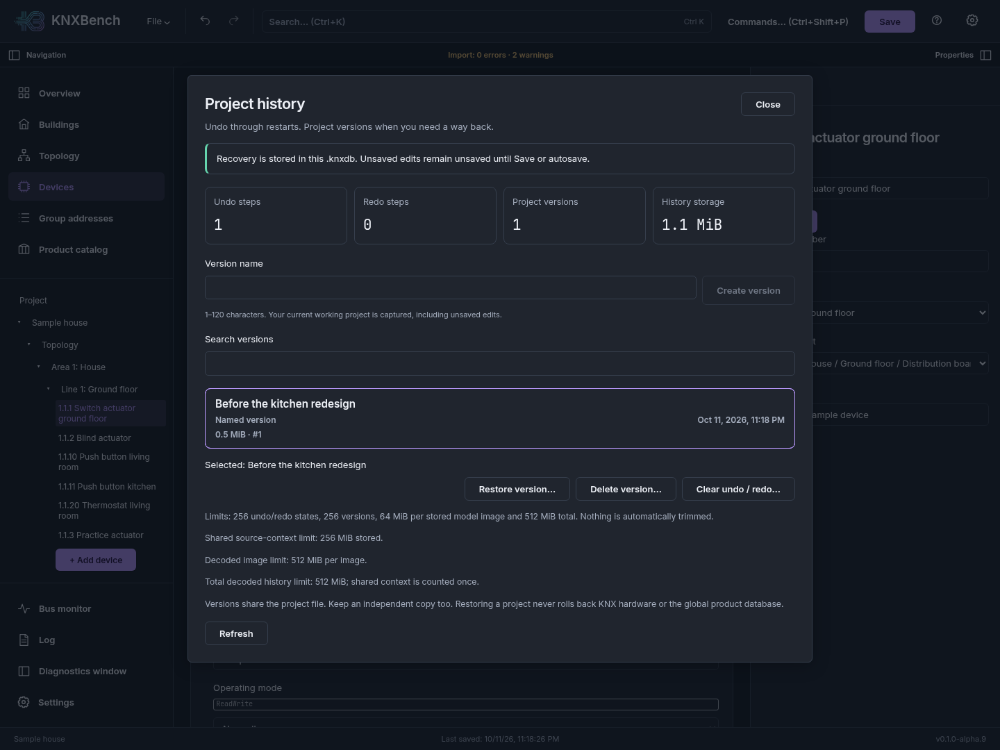

← Previous: [The user interface](01-user-interface.md) · [Manual index](../README.md)

# Projects: create, open, import, save, export

**Goal:** choose the right file operation and keep a reopenable working copy.
**Prerequisites:** a running app, plus a backed-up file if importing or opening one.
**Expected result:** a saved `.knxdb`; an ETS import also has a report to review.
**Watch out:** browser Save writes on the server; Export project downloads a copy.
Neither produces an edited ETS `.knxproj`.

KNXBench works with two project files, and it is worth being clear about them before
anything else:

- **`.knxdb`** is KNXBench's own project file. It is a SQLite database, it is the
  working format, and it is the only format that keeps everything KNXBench knows about
  your project.
- **`.knxproj`** is the ETS project archive. KNXBench reads it and never writes one.
  It is the way a project gets *in*; once imported, your work lives in `.knxdb`.

Everything in this chapter is reachable from the **File** menu, and most of it also
from the command palette (`Ctrl+Shift+P`).

When no project is open, the welcome workspace offers three separate cards:
**New project…** starts from scratch; **Open KNXBench project** continues a saved
`.knxdb`; **Import ETS project** reads a `.knxproj`. Import never turns an ETS
archive into a file you edit in place. Save the imported work as `.knxdb` later.

## Import selected lines or devices into the open project

**Source integration, 10 October 2026 — not a release claim.**
[Separate acceptance](../../status/2026-10-10-import-expansion-integration.md). Use
**File → Import selected lines/devices…**, choose a `.knxproj`, its installation
and the destination installation, then select devices or whole lines. Review
included group addresses/communication objects, ID mappings, reuse notes and
the source import report before confirming. Conflicting addresses/settings or
a changed project refuse rather than silently overwriting existing data.

The source archive is not modified. Required source dependencies are imported
in one undo step; Save/Open preserves the working model and retained context.
Complete retained archives may include unselected confidential data. Confirm
retention only after review, keep native copies private, and remember that
**Undo does not erase retained source evidence**. There is no building-only or
new command-palette selector. Whole-project replacement import is unchanged.
[CLI and bounds](../../SELECTIVE_IMPORT.md) ·
[verification](../../status/2026-10-10-import-expansion-verification.md).

## Review the complete original import report

**Since Alpha.10.** In
**Overview**, choose **Show full import report**. The report is loaded only when
you request it. **Download full report** saves the complete original JSON locally;
the expandable preview shows at most 65,536 characters and can end within a value.
Unknown fields and large numbers remain unchanged in the downloaded report.

After importing through the server and saving a native copy, reopening that copy
restores the original report and warning counts. **Historical import findings**
means recorded original findings, not a new compatibility or hardware check.
Older native files that never stored a report remain explicitly unavailable.
Changing projects invalidates the panel's old result; ordinary edits do not
rewrite the original report. A corrupt or unsupported stored report refuses Open
without replacing the current project.

**Privacy:** a complete report and native copy may contain source names, attributes
and other confidential data. Review them before sharing; the preview is not
anonymization. There is no automatic upload. CLI `import --store` now captures
the same original report; earlier CLI files without it remain unavailable.
Source-scoped selective reports are not a primary destination timeline.

**Show source report catalogue** separately lists retained reports from selective
imports. Select the source and choose **Read selected source report** before
**Download source report**. The source's full recorded name, scope identity and
availability are shown outside the selector; source counts do not replace the
main project's counts. An archive with no stored report says **Report unavailable**,
not zero issues. Changing/revising the project invalidates an old read. Full
local downloads can contain confidential data; review them before sharing.
[Exact contract and bounds](../../contracts/native-import-evidence.md).

## Retained payloads, project information and native export

**Since Alpha.10.**
**Show retained payloads** in the Overview's Import report card lists attachments
and extension files that the import kept byte for byte (for example from
`UserFiles` or an add-in). Nothing is opened, rendered or run. Pick one and choose
**Download selected payload** to save the exact bytes locally; a payload over the
server's download limit stays listed but cannot be downloaded here.

**Show modeled project information** in the Technical details card lists the
project facts KNXBench holds — identifier, name, number, group-address structure,
recorded completion, stored dates and schema versions — read-only. *Not recorded*
and *Explicitly empty* are different answers.

**File › Export project…** now asks first: the native `.knxdb` can contain original
imported data, attachments and import reports, and it is not anonymized.
**Cancel** has the focus. The download is bound to the project state you reviewed;
if the project changes in between, review the export again.
[Payloads](../../contracts/project-payload-catalogue.md) ·
[project information](../../contracts/modeled-project-metadata.md) ·
[export privacy](../../contracts/native-export-privacy.md).

## Import and open progress

Whole-project import and native Open show a banner until the request ends.
The **Current step** line sits below the bar and reflects the latest phase
reported by the server, including master-data ingestion, product enrichment,
passthrough storage and project-tree construction. Counts such as **13 of 251**
are measured items within one phase, not a percentage of the whole import.
When a phase has no item total, the bar shuttles and an explicit note explains
why there is no count; the current step remains visible. A moving bar is not
proof that the server is making progress, and no ETA or fine-grained activity
inside an uncounted phase is inferred.

Decorative jokes stay for **4.3 seconds** each (previously 1.8),
independently of phase updates. The step and joke text are two typographic
points larger. Reduced-motion settings still suppress rotation; failure
removes the bar and jokes and retains the last phase and error.

## Installation nodes and their names

**Source published on main, 11 October 2026 — not included in Alpha.8.**
[Actual merged-source verification](../../evidence/installation-node-publication-2026-10-11.json).
An installation
is the container below **Project** that groups topology, buildings, unassigned
devices and group addresses. It is not a device or a line. One project can contain
several installations, so the nodes must remain separate even when unnamed.

An empty or whitespace-only imported name is displayed as **Unnamed installation
(ID …)**. This is a translated display label, not a name written into the imported
project. Named installations keep their original spelling; the ID distinguishes
unnamed nodes without depending on their order.

Select the installation's **label** in the Project Explorer to open its Properties.
The explanation and **Name** field appear there, including at narrow window sizes.
The **arrow** still expands or collapses the subtree. Edit the name and press
**Enter**, or leave the field, to submit it; **Escape** cancels the draft. Blank new
names are refused. The existing server admission trims an explicitly submitted
name; merely viewing an imported name does not trim or change it. A refusal is
shown beside the field. One rename affects only the selected installation and is
one undoable action. Use Save/autosave for the native working file as usual.

An unrelated snapshot refresh keeps an unsubmitted draft. Pending writes cannot
be submitted twice from the same field. A reply arriving after a snapshot/target
change or unmount is not applied to the replacement view; this does **not** cancel
an already submitted server operation. The unchanged installation API is not a
revision-conditional multi-client edit protocol.
[Behavior and acceptance boundary](../../contracts/installation-node.md).

## Starting a new project

**New project…** opens a wizard. The first step asks for four fields:

| Field | What it does |
| --- | --- |
| Project name | The name of the project. Pre-filled, and selected when you focus it, so you can just type over it. |
| Installation name | The name of the installation inside the project. |
| Project language | Starts with your current interface language. Select English, German or an installed language pack, or choose **Another language tag…** and type a well-formed tag such as `de-DE`. This labels the project texts; it does not switch the interface language. There is no restricted list of project languages. |
| Group address style | `ThreeLevel` (`1/2/3`), `TwoLevel` (`1/2`) or `Free` (a plain number). |


The next steps are optional and describe a starting structure:

| Step | What you can set up |
| --- | --- |
| Topology | Areas and lines with number, name and medium reference (`MT-0` by default; stored as typed, not interpreted). Area 1 with line 1.1 is pre-filled; remove it if you do not want it. |
| Building | Buildings with floors, rooms and distribution boards. **Add floors** adds a number of consecutively numbered floors at once. Other building-part kinds remain available in the project explorer. |
| Group structure | Main groups and, in three-level style, middle groups. A preset fills the list from a fixed set of functions (lighting, shading, heating, ventilation, central functions) and the floors of the Building step, either *function, then floor* or *floor, then function*. Main groups are numbered from 1, middle groups from 0; everything stays editable. Free-style projects skip this step. No group addresses are created. |
| Review | What will be created, and links back to any step that still has a problem. |

**Create project** works from every step, and **Enter** in a field of the first step
or on Review creates the project straight away with whatever is entered so far.
Problems such as a duplicate line number or a middle group above 7 are shown on
their step and keep **Create project** disabled until they are fixed. The server
checks the structure again with the same rules the explorer uses; if it refuses,
nothing is replaced and the wizard stays open with the server's message. The
structure arrives together with the new project, so it is not an undo step: the new
project is its own starting point.

After creating, the wizard shows that the project is open but not yet saved and
offers **Add devices now**, which opens the
[add-device wizard](05-devices-and-products.md#the-add-device-wizard) on the
project's first line. Leaving the wizard with **Cancel** or **Escape** after you typed something asks
first; pressing **Escape** again keeps you in the wizard.

Creating the project does not choose a filename or write a project file. **Save** or
**Save As** later chooses the `.knxdb` filename and location; the project and
installation names are not paths. At narrow window sizes the dialog scrolls to
keep every field and action reachable.

The group-address style is a project-wide decision and it is first made here. See
[Working with group addresses](04-group-addresses.md) for what that choice means in
daily use and how to change it later; the **Project** node in the properties pane
changes it as one undoable step.

> **Warning**
>
> If a project is already open and has unsaved edits, creating a new project asks you
> first, and offers to discard those edits. Discarded edits are gone — there is no
> second undo stack behind that prompt. Save first if you are unsure.

## Opening a KNXBench project

**Open (.knxdb)…** opens a project KNXBench saved earlier. This is the lossless path:
what you saved is what you get back, including the parts of an imported ETS file that
KNXBench preserves but does not model (see below).

A file that is not a KNXBench project — another program's database, an empty file, or a
KNXBench file in which nothing was ever saved — is refused with "this SQLite file was not
created by KNXBench" or "no project has been saved to this file". KNXBench does not
change the file. The command-line readers (`knx doc-export`, `knx ga-export`,
`knx diff`) behave the same way, and a mistyped path is reported, never created.


The picker looks different depending on how you run KNXBench. The desktop build opens
your desktop's own file dialog. The web build — the one in the screenshot — browses
the directory the server is allowed to see, and offers an **Upload…** row for files
that are on your machine rather than on the server's. See
[Web and Docker deployment](11-web-and-docker.md) for what the server can and cannot
reach.

The web picker's upload area also accepts dropped files or a multi-file choice.
It uploads them one at a time, stops at the first failure and reports which file
failed; an upload does not automatically select or open a project. After an
upload, select the file from the server-side list to open it.

## Importing an ETS project

**Open project…** imports a `.knxproj` file. The file is read; it is never written
back to. Whatever you do afterwards happens in memory and, once you save, in a
`.knxdb` of your choosing.

While the import runs, a banner shows the file name, the phase the importer is in, and
a count where the server can give one.


The banner walks through seventeen named phases — opening the archive, detecting the
schema version, parsing the topology, validating references, inferring datapoint
types, ingesting manufacturer data, and so on. The bar only fills proportionally while
the server is reporting a "phase N of M" pair; before that it moves without claiming
to know how far along it is. The cheerful line underneath is decoration. The phase
line above it is the one that tells you something.

### What the import actually understands

KNXBench detects the schema version of the file and imports accordingly. What has been
verified against real files, and what has not, is a distinction this project takes
seriously:

| Schema | ETS generation | Status |
| --- | --- | --- |
| 11 | ETS 4 | Reading verified against a real project, with counts pinned by tests |
| 20 | ETS 5.7 | Reading verified against three small public sample projects; objects in nested sub-modules lose their number and module, and are reported |
| 21 | ETS 6.0 | Reading verified against a real project, including a save and reopen back to an equal model |
| 23 | ETS 6.3 | Reading verified against real projects; no round-trip claim |
| 12, 13, 14, 22 | ETS 4, ETS 5 up to 5.6, ETS 6.1 | Refused with a message that names the schema; no sample with devices has been measured |

A refused file is not damaged: KNXBench does not guess at a format it has not measured.
If you have ETS 6.3, re-exporting the project from it gives schema 23. The full evidence table, test names included, is in
[Compatibility](../../COMPATIBILITY.md).

> **Note**
>
> Older ZipCrypto-protected ETS4/ETS5 projects can request a project password in
> the interface; the CLI also accepts password input. This path has synthetic
> regression coverage, not a verified protected ETS export. AES-protected ETS6
> containers are still refused by name. See [Supported and unsupported](../reference/02-supported-and-unsupported.md#password-protected-projects).

### The import report

KNXBench does not silently drop anything it fails to understand. Everything the
importer meets falls into one of these buckets:

- **Understood** — mapped into the project model.
- **Preserved opaque** — kept byte for byte, with its size and a checksum recorded,
  so it survives a save and an export even though KNXBench cannot interpret it.
- **Reported** — unknown elements and attributes, inferred values (a datapoint type
  derived from linked communication objects, for example), conflicts, unsupported
  features, and outright errors.

You see the result in three places:

1. **The Overview**, where import errors and warnings appear as counts in the
   *Import report* card. Since Alpha 10 a non-zero count has a **Show in log** link
   that opens the Log narrowed to exactly those import entries.
2. **The Import: N errors · M warnings button** in the strip under the header, which
   takes you there. Since Alpha 11, the error and warning
   counts at the foot of the Explorer open the same narrowed Log.
3. **The Log**, which carries one entry per finding: one per import error, one per
   unknown construct (with how many times it was seen and where), one per opaque
   entry (with its size and checksum), one per datapoint-type conflict, and one per
   unsupported feature.

The structured report itself — counts read versus mapped, every unknown construct,
every opaque summary — is written as JSON by the command line:

```bash
knx import project.knxproj --store project.knxdb --report-json report.json
```

See [The command line](10-command-line.md) and, for the report's exact shape,
[Import and export](../../IMPORT_EXPORT.md).

> **Note**
>
> Log entries are the server's own text and stay in English, whatever language the
> interface is set to. They are written to be pasted into a bug report.

## Saving

**Save** writes the project to its file. If the project has no file yet — which is the
case for every newly created and every freshly imported project — Save asks where to
put it, exactly as Save As does. The suggested name is `project.knxdb`.

**Save As…** always asks.

In the browser, Save As writes to the server's permitted directory, not to your
computer's Downloads folder. To obtain a copy locally, choose **Export
project…** from the File menu after opening a project. This exports a freshly
serialized `.knxdb` from the current in-memory project; it is not a substitute
for saving changes on the server. The native desktop build uses its own file
dialog for Save As and does not show the browser-only Export project item.

**Autosave** is on by default, every five minutes, and only for a project that already
has a file: it never asks for a filename on your behalf, and it skips the turn when
nothing changed. Five seconds before it saves, a notice counts down with a **Cancel**
button. A failed autosave says so and leaves the project marked unsaved. Turn it off
or change the interval (1–120 minutes) in
[Settings](09-settings-and-appearance.md#autosave).

### What "unsaved changes" means right now

KNXBench compares the current project contents with a clean baseline established by
opening, importing, creating, or successfully saving a project. Undo history is
separate: saving keeps that history but clears the modified state; undoing edits back
to the baseline is also clean. A failed save does not clear the modified state.

In the desktop build, quitting with a modified project asks first, and offers
**Keep editing**, **Quit without saving** or **Save and quit**. In the web build there is no
Quit item — a browser tab cannot close itself — so nothing intercepts a closed tab.

Opening or importing another project while the current one has unsaved edits asks the
same way (since 2026-10-06): **Keep editing**, **Discard changes and open** or **Save
and open**. (Before 2026-10-12 the first answer was labelled **Cancel**, and the middle
one could render without a readable label.) "Save and open" opens the other project
only after a save that left the current one clean, and only if you did not withdraw
the decision with **Keep editing** or Escape while the save was running; the server refuses the replacement too, so a script calling the API cannot
discard edits by accident either (`409`, kind `projectUnsavedChanges`, until it resends
with `discardChanges: true`).

> **Warning**
>
> Closing the browser tab of the web build does not warn you about unsaved edits. Save
> before you close it.

## Project history: restart-safe undo and versions

Alpha 9 includes **File → Project history**, also available through the command
palette. Before first
**Save As**, the panel explicitly says history is session-only. For a native-backed
project, acknowledged reversible edits, Undo and Redo persist immediately. Opening
that file after a server/app restart restores the working project and both stacks.
Changes can therefore recover while still marked unsaved: Save/autosave controls
the clean baseline. Closing without saving does not erase the recovery journal.



*The fictional Sample house has already been saved to a native file. A version is
a way back from an edit, not a second copy of that file.*

The panel shows undo/redo counts, image-payload usage and admission limits. Create
a **named version** before a redesign, independently of autosave; search the list
and select a version to restore. Save/autosave also keeps the preceding distinct
saved state. Restore asks explicitly, preserves the complete current working state
as a **Before restore** version and then atomically replaces the project. It clears
the edit stack; to go back, restore the preserved version. Cancel is initially
focused and does not send a mutation. Changed revisions or server lifetimes
invalidate old confirmations; reopen/refresh rather than forcing stale consent.

Deleting a version or clearing undo/redo requires confirmation. Nothing is
silently trimmed when a limit is reached; a failure is reported and the project
stays unchanged. Until the limit is resolved, a native-backed edit can be refused.
Versions are stored **inside the same `.knxdb`**. They protect against an unwanted
edit, not file/disk loss: keep independent copies of closed files. They preserve
project data, opaque source bytes and manufacturer references, not the global
catalogue, passwords or device/bus state. Alpha 10 uses native schema 14; Alpha 9
and earlier refuse upgraded files. Independently back up closed files before
upgrading. Downgrading means returning to the pre-upgrade backup, not pressing Undo.
Browser **Export project…** remains a fresh current-project serialization, not a
copy of the source file's complete history. See [the detailed contract](../../PROJECT_HISTORY.md).

## There is no `.knxproj` export

Until 2026-09-20 there was an **Export to .knxproj…** item in the File menu. It is
gone, together with the code behind it, and it is not coming back:
[ADR-0028](../../adr/0028-no-knxproj-export.md) records the decision. Import is
one-way. Once a project has been read into KNXBench, it stays in `.knxdb`.

If you have a screenshot, a script or a habit that expects that item, this is what
changed and what to use instead:

| You want to | Do this instead |
| --- | --- |
| Keep working on the project | Save to `.knxdb` — it keeps everything KNXBench knows |
| Hand group addresses to another tool | **Export group addresses (CSV)…** — [Working with group addresses](04-group-addresses.md) |
| Hand someone a readable account of the project | **Export documentation…** — [Documentation export and project comparison](08-reports-and-diff.md) |
| Give a colleague the original ETS file | Give them the `.knxproj` you imported; KNXBench never modified it |

The short reason: an exported archive was unsigned, no real ETS installation was ever
available here to test whether ETS would accept it, and maintaining a writer nobody
could verify cost more than it returned. A file KNXBench cannot promise ETS will open
is not a file KNXBench should write.

## The rest of the File menu

Four more items are covered elsewhere:

- **Export group addresses (CSV)…** and **Import group addresses (CSV)…** —
  [Working with group addresses](04-group-addresses.md).
- **Export documentation…** and **Compare with…** —
  [Documentation export and project comparison](08-reports-and-diff.md).
- **Debug report…** writes a log-based report for bug reports, with IP addresses
  removed. It still contains group addresses and the names of imported elements, so
  read it before you attach it to anything public. The larger dialog scrolls inside
  its window; drag its lower-right corner or focus the top-right resize button and
  press the arrow keys to make room for the contents and privacy notice.
- **Show introduction…** reopens the four-page introduction that appears on the
  first start — [First start](../getting-started/06-first-start.md#the-introduction).

[Manual index](../README.md) · Next: [Buildings and topology](03-buildings-and-topology.md) →
