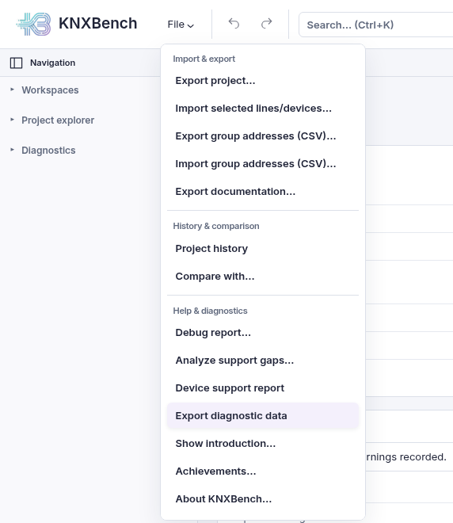
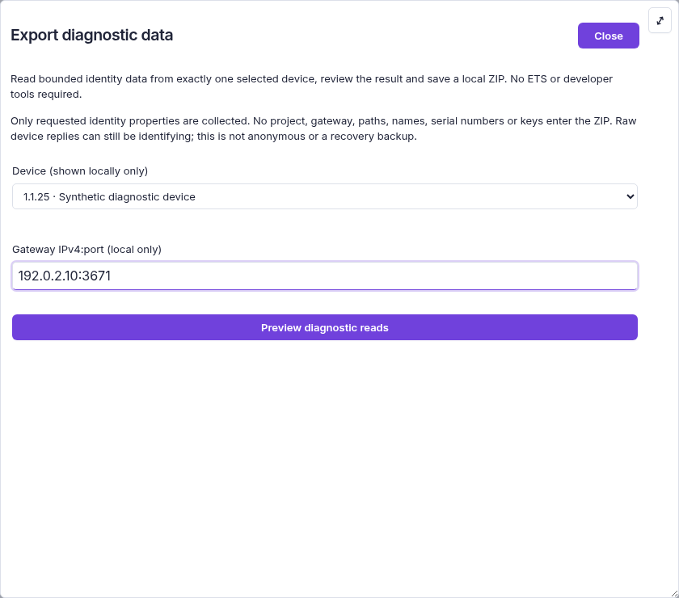
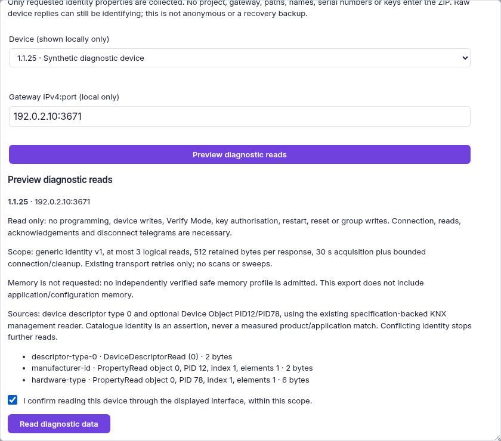
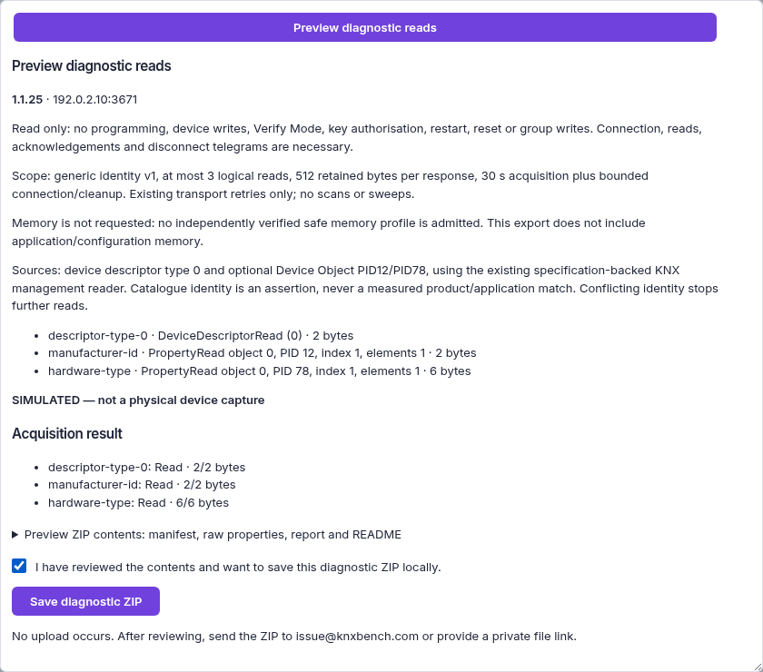

← Previous: [Bus monitor and KNXnet/IP](07-bus-and-interfaces.md) · [Manual index](../README.md)

# Documentation export and project comparison

**Goal:** produce a readable project report or compare two saved snapshots.
**Prerequisites:** an open project for a report; a second compatible `.knxdb` for comparison.
**Expected result:** a self-contained HTML file or a list of differences.
**Watch out:** review names and addresses before sharing a report. A diff does not
merge changes, and browser Print to PDF is not a native PDF exporter.

Two things you will eventually want from any engineering project: a document that
describes it to someone who cannot open it, and an answer to "what changed?". KNXBench
has one feature for each.

<a id="monitoring-export"></a>
## Offline monitoring export (source builds since 21 October 2026)

**File → Import & export → Monitoring export…** prepares a reduced snapshot of
one installation. It does not contact the KNX bus, require an ETS file or upload
anything. Available in source builds containing `4eee65d8` or newer;
[internal acceptance is complete](../../IMPLEMENTATION_STATUS.md#monitoring-snapshot-export--source-delivery).
This is not a new tagged release or verified receiving-tool integration.

Choose the installation, optionally choose a text language, and request a preview.
Review the selected/exported/omitted entity counts and diagnostics before choosing
**Download ZIP**. A project edit or changed catalogue-derived output invalidates
the review: preview again rather than downloading an older selection. The dialog
shows only a bounded diagnostic window; the complete report is inside the ZIP.

The ZIP contains:

- `project.json`: current names, addresses, objects, links, topology, rooms and
  Functions in the deliberately reduced `monitoring-sparse-v1` profile;
- `export-report.json`: counts, unavailable fields, omissions and the SHA-256 of
  the exact project JSON;
- `README.txt`: scope and handling instructions.

**Not a backup.** Parameters, notes/instructions, manufacturer source files,
attachments, keys, history and recovery data are excluded. Unknown group security
and individual object flags are omitted and reported, not converted to `false`.
Addressless devices and their objects are omitted explicitly. Duplicate addresses,
ambiguous ownership and invalid hierarchy/reference graphs refuse the export.
The profile is not a complete external engineering schema; a receiving tool needs
its own separately tested JSON adapter. Renaming JSON to `.knxproj` does not make
it an ETS archive.

Names, room labels and installation addresses are private content. Review the ZIP
before sharing; local export is not anonymization. Keep the original `.knxdb` for
editing and recovery. For headless use see
[`knx monitor-export`](10-command-line.md#monitor-export).
[Engineering boundaries](../../contracts/monitor-project-export.md).

<a id="report-problem"></a>
## Reporting a problem (source builds after Alpha 18)

> **Which build has it?** Source builds after the Alpha 18 release only. Alpha 18
> and older have the separate **Debug report…**, **Device support report** and
> **Save report** buttons described further below.

**File → Help & diagnostics → Report problem…** (*Datei → Hilfe & Diagnose →
Problem melden…*) is the one place to report a problem. The command palette
(Ctrl+Shift+P) has the same entry. It collects what helps find the cause into
one ZIP file on your computer. Nothing is uploaded: you choose what goes in, look
at it, save it and send it yourself.

Several places open the same wizard with the right things already chosen:

| Where | Opens with |
| --- | --- |
| **Report problem…** in a device's preparation panel or refusal help | *Programming a device*, the current device, explicitly no earlier run |
| **Report problem…** in **Help verify this device** | *Programming a device*, that exact ended download and its own target, not the next form selection |
| **Report problem…** under a System-2 result | *Programming a device*, that System-2 operation |
| **Report problem…** after **Export diagnostic data** has read a device | *Reading or diagnosing a device*, that device and that exact retained read |
| **Report problem…** after **Read device identity…** | *Reading or diagnosing a device*, that exact retained identity result; a manual address is not guessed to be a project device |
| **Report problem…** on a device's **Diagnostics** tab | *Reading or diagnosing a device*, that device |

### Reading an identity without a project

**File → Help & diagnostics → Read device identity…** (*Geräteidentität lesen…*)
accepts a known individual address without an open project, or a manual address
outside the current project. A project device can also be selected. Optional
application and mask assertions help define the bounded identity profile.

Opening this action and **Preview identity read offline** do not contact a device.
Review the target, profile, exact queries and time limit. Enter the gateway and
give the separate live-read consent before **Read identity now**. This only reads
bounded identity data: no memory dump or device write. Ask the installation owner
first and free the gateway tunnel. Closing hides late replies but cannot undo a
read already sent. A project/server/revision change invalidates this view; an
equal refresh keeps it.

Once the read ends, **Report problem…** opens the same wizard described below.
Read consent never grants sharing consent. There is no second save/mail dialog.
The exact retained result remains usable without a recording while the server
still retains it; expiry is reported, never replaced with an unrelated latest run.

### Step 1: what kind of problem

Choose one of five kinds: **Programming a device**, **Reading or diagnosing a
device**, **Importing a project**, **Product catalogue or product installation**,
**User interface or something else**. Each kind ticks its own sensible contents in
the next step. Nothing is collected yet.

### Step 2: contents

The wizard now asks KNXBench what it can collect and shows one checkbox per part:

- **Version and environment** is always included and cannot be unticked.
- **Recording of the operation**: the device operation the report is about. The
  list preselects the latest one that fits, or the one you came from; you can
  choose another. **Earlier operations** adds more recordings.
- **Device extract** (application, parameter values, linked group addresses),
  **Short reports of this operation**, **Session log**, **Import report**,
  **Catalogue and product identity**, **Whole project (.knxdb)**, **Bus monitor,
  last 10 minutes** and, for user-interface problems, **Browser state** (language,
  theme, window size, zoom, the last error messages).
- A part that cannot be included is greyed out with the reason, for example
  *the bus monitor is not running*.

Every included part shows its size, and the total is below the list. Above
10 MiB the wizard warns that many mail services refuse attachments that large;
KNXBench does not split the file. Browser state is limited to 64 KiB of serialized
UTF-8, including JSON escaping. The newest errors have priority; shortening and
omission counts are shown. Unticking Browser state omits that payload entirely
and you can select it again.

The preview binds the resolved operation, target, project/server/revision and
selected contents. Text and ZIP requests use that same review. Changed content
or context refuses the request and withdraws consent: choose **Refresh and
review**, then inspect it again. A substantive accepted project update closes
the wizard, including pending replies; an equal tree refresh does not.

### Step 3: preview

Each part lists its size, number of entries and what it contains: *contains
addresses*, *contains names*, *contains parameter values*, *contains network
addresses*. **Show content** displays the part as text, exactly as it goes into
the ZIP.

**Always removed, even with your consent:** device keys (BCU keys), KNX Secure keys
and tool keys, tunnel and login passwords. Where they were, the file says what was
removed and how long it was, never the value. **Not removed:** individual and
group addresses, names, parameter values and the network addresses of gateways in
the parts you chose. Review the preview before you share the file.

### Step 4: save and send

Optionally describe what happened (no passwords). Tick **I have looked at the
preview and want to save this ZIP on this computer**, then press **Save ZIP**
(*ZIP speichern*). Nothing is written before that. The file is called
`knxbench-diagnostics-<version>-….zip` and is saved like any other KNXBench
download (the desktop app asks where).

The wizard says **Download requested**: clicking a blob link does not prove a
completed save, especially if a later desktop save dialog is cancelled or fails.
Verify that this ZIP exists, retry the download if necessary, and explicitly tick
**I have saved this ZIP and verified that the file exists**. Only then does
**Open mail draft** become available. A retry, refusal or content/context change
clears that acknowledgement; it is never automatic.

**Open mail draft** opens your mail program with a message to `issue@knxbench.com`,
the KNXBench version and operation in the subject. The
draft has **no attachment**: attach the saved ZIP yourself. **Email is not
encryption**: anyone who handles the mail on its way can read the file.

**Open a public GitHub issue** opens the issue form with only the KNXBench version
and the kind of problem, never the ZIP or anything from it. Use it for problems
you are happy to discuss in public; send the ZIP by mail.

### Recordings: what is kept and how to delete it

KNXBench records the device operations of this server (reading and analysing,
compare, downloads, System-2 download and recovery, addressing by serial number,
device service control, line scan): every telegram, timings and the outcome, with
the KNXBench version. Keys and passwords are never recorded. The recordings live in
the `diagnostics/` folder of the data directory (for Docker on the mounted
volume). KNXBench keeps the last **100 operations or 512 MiB**, whichever comes
first, and removes the oldest first; failed operations are kept longest.

**Delete recordings…** in step 2 deletes all of them after a confirmation;
recordings being written at that moment are kept and named.

Operators of shared or customer servers can switch recording off by starting the
server with **`KNX_DIAGNOSTIC_RECORDING=off`** (also `0`, `false` or
`disabled`). There is no switch in the interface. The wizard and the ZIP then say
plainly that recording is off; older recordings can still be included.

<a id="send-diagnostic-data"></a>
## Sending diagnostic data from one device

When a maintainer asks for data from one of your devices, for example in a
device-support issue, KNXBench can read a few identity values from that device
and pack them into a ZIP for you to email. You need no ETS, device reader or
developer tool. The export only reads: nothing is programmed, written, restarted
or reset.

> **Which build has it?** Alpha 14 and newer: the AppImage, the Docker Hub image
> `knxbench/knxbench-server:0.1.0-alpha.14` (or `latest`) and source builds.
> Alpha 13 and older do not have it; [update first](../getting-started/04-installation.md).
> **File → About KNXBench** shows which build you are running.

### Before you start

- **Permission.** Ask the installation owner before you contact their bus.
- **The project.** Open the project that contains the device, either a `.knxdb`
  or an imported `.knxproj`. The device needs its individual address.
- **The interface.** You need the IPv4 address and port of a KNXnet/IP interface
  that the KNXBench machine can reach. The port is usually `3671`. Docker
  installations need `--network host`, as in the installation guide.
- **A free tunnel.** Close ETS and any other tool that uses the same interface.
  Many interfaces offer only one tunnel, and KNXBench refuses rather than queues.
- **The device.** It must be powered and running normally on the bus. You do not
  need to press the programming button.

The whole run takes about a minute, most of it spent reading this page.

### Step 1: open the export

Open **File**, open the *Help & diagnostics* submenu and choose **Export diagnostic
data**. In the German interface this is **Datei → Hilfe & Diagnose →
Diagnosedaten exportieren**. (The screenshot below predates the submenus and shows
the entry in the older grouped list; the entry is the same.)

Since Alpha 17 you can also select the device
and press **Analyse device** on its **Diagnostics** tab: the same dialog opens
with that device already chosen
([device panel](05-devices-and-products.md#device-analysis-and-support)).



### Step 2: choose the device and the interface

Pick the device in the list. Each entry shows its individual address and name.
Enter the interface as `IPv4:port`, for example `192.168.1.20:3671`; a saved
preferred interface is filled in for you. Since Alpha 17
the dialog also asks for a **Diagnostic profile** (*Diagnoseprofil*): keep
**Generic identity** unless a maintainer asks for the memory ranges
([see below](#reading-declared-memory-ranges-system-2)). Then press **Preview
diagnostic reads** (*Diagnoselesungen prüfen*). Nothing is sent to the bus yet.



### Step 3: check the preview and read

The preview shows the target device, the interface and exactly three reads:

1. the **device descriptor** (the mask version),
2. the **manufacturer ID** (property 12 of the device object),
3. the **hardware type** (property 78 of the device object).

If that matches what you expect, tick the confirmation and press
**Read diagnostic data** (*Diagnosedaten lesen*). Reading takes a few seconds;
KNXBench gives up after 30 seconds plus connect and disconnect time. **Stop
reading; keep partial results** ends the run early. The values already read
are kept and the connection is still closed properly.



### Step 4: check the result and save the ZIP

Each read shows one of these results:

| Result | Meaning |
| --- | --- |
| **Read** | The value arrived complete. |
| **Partially read** | An answer arrived, but with an unexpected length. It is kept as received. |
| **Refused** | The device denied access or does not offer this value. KNX does not say which. |
| **Error** | For example no answer, a timeout or a stop. Values read earlier are kept. |
| **Not read** | The run ended before this read. |

Every outcome is useful, so send the file even if not everything says *Read*.
In source builds after Alpha 18 the result offers **Report problem…** instead of the
confirmation and save button below: it opens the [report wizard](#report-problem)
with this read preselected. The rest of this step describes Alpha 18 and older.
**Preview ZIP contents** shows exactly what goes into the file. Tick the
confirmation and press **Save diagnostic ZIP** (*Diagnose-ZIP speichern*). The
file is called `knxbench-device-diagnostics-….zip`; it is saved like any other
KNXBench download.



These pictures were taken with KNXBench's built-in simulator and a fictional
device, which is why they show *SIMULATED — not a physical device capture*.
A run against a real device does not show that line.

### Step 5: email the ZIP

Send the ZIP to **`issue@knxbench.com`**:

- **Subject:** the issue number and the device, for example
  `Issue #42: diagnostic data for <device model>`.
- **Attachment:** the ZIP exactly as saved. Do not unpack or edit it; its
  checksums would no longer match.
- **In the message:** the issue number, your KNXBench version from
  **File → About KNXBench**, and anything else the maintainer asked for in the issue
  (for example the firmware version printed on the device label).
- **Leave out:** project files, keys, passwords, backups and serial numbers.

Nothing is uploaded automatically. Email is not confidential; a private download
link works just as well.

### What the ZIP contains

The ZIP holds four files: `manifest.json` (checksums), `report.json` (results and
timings), `properties.json` (the raw bytes of each read) and `README.txt`. It
contains no project or device names, no individual addresses, no interface, no
paths, no serial number and no keys. The raw replies do identify the device type,
which is the point, so share the file like any other installation document.

The file is **not a backup** and cannot restore a device. Configuration memory
is not read. The export has been tested with KNXBench's simulator and, so far,
with 46 real devices from eight manufacturers; every further report from a
real device helps confirm it on hardware. If a device behaves differently
afterwards (not expected, since the export only reads), please say so in the
issue.

<a id="reading-declared-memory-ranges-system-2"></a>
### Reading declared memory ranges (System-2)

> **Which build has it?** Alpha 17 and later. Alpha 16 and older
> offer this profile on the command line only.

For a System-2 device whose application is in KNXBench's product database, a
maintainer may ask for the second profile, **System-2 declared memory ranges
(needs product data)** (*System-2: deklarierte Speicherbereiche*). Choose it in
step 2 before **Preview diagnostic reads**; changing the profile afterwards
discards the preview and its confirmation, like changing the device or the
interface.

- **What it reads.** First the same three identity values. Only if the device
  shows exactly the mask, manufacturer and hardware type its product data
  asserts does KNXBench read the memory ranges that the application's load
  procedure declares, 12 octets per request. Otherwise it stops without any
  memory read.
- **The preview** names the application, the identity values required before
  any memory read, every declared range (address and length) and the total
  number of octets and requests. Nothing is sent yet.
- **Progress** counts identity reads and memory reads separately. **Stop
  reading** keeps what was already read, as for the generic profile.
- **The result** lists, per declared range, how many octets were read, refused,
  partially read, failed or not read. The ZIP gets a fifth file,
  `memory.json`.
- **Refusals before anything is sent.** Without a product database, without
  the device's application in it, for an application of another shape, or when
  the product data does not state both mask and manufacturer, the preview is
  refused with an explanation and nothing is read. Use the generic identity
  profile instead.
- **No ZIP for a run that never reached the device.** If the run stops before
  the interface connection (for example the interface is busy), the dialog
  says so and offers no ZIP; preview again to retry. Pressing **Stop reading**
  that early is the exception: the ZIP can still be saved and records that
  nothing was read.
- **Keep the memory ZIP private.** Raw memory can contain texts and parameters
  configured into the device, such as names or settings.

**Keep this ZIP private.** The memory contains device configuration. The ranges
are where the product data says the application lives, not proven runtime
addresses, and the file is **not a backup** and cannot restore a device.
Nothing is written to the device. This profile has been tested with
KNXBench's simulator only, not yet on a real device.

The same export is available on the command line as `knx device diagnostics`;
see [the command-line chapter](10-command-line.md). The exact behaviour and
limits are in the [contract](../../contracts/device-diagnostic-export.md).

<a id="universal-device-support-reporting-source-after-alpha-11"></a>

## Universal device-support reporting

> **Source builds after Alpha 18** no longer show this dialog: the File menu entry,
> the download panel's button and **Send report** on the **Diagnostics** tab open
> the [report wizard](#report-problem) instead. The server route stays for older
> clients. The rest of this section describes Alpha 12 to Alpha 18.

This separate workflow needs **no open project**. Open **File → Device support report**, or use the same action in a device's download panel. Available since
Alpha 12. Since Alpha 17, **Send report** on a device's
**Diagnostics** tab opens the same dialog with that device selected.

1. Select a project device, or keep manual identity and optionally enter its local
   individual address. Enter an application ID, mask or firmware only if known;
   unknown fields are a valid report, not a reason to invent values.
2. Generate the offline preview. It states fact origins, known support/refusal and
   missing/withheld evidence even without an installed product package or plan.
3. Optional: expand live diagnostics, review the local target and **exact read
   list**, enter one gateway and give acquisition consent. No scan, setup, key,
   write, restart or download is performed. Unknown families stay descriptor-only;
   reads may be unavailable. This is still active bus communication: obtain the
   installation owner's authorization before using it.
4. Optional source context needs a separate rights confirmation. It contains only
   a bounded reviewed numeric projection, not original XML, firmware or binaries.
   Do not include protected assets merely because a download URL is public.
5. Inspect both the summary and JSON. Confirm disclosure separately, then save
   the local ZIP. Its two files are `report.json` and `README.txt`. Input/target/
   project changes invalidate the old preview and consents; previews expire after
   fifteen minutes and another tab's preview can replace yours.
6. Deliberately open an issue form or mail draft and attach the saved report
   yourself. Nothing uploads automatically. Email is not a privacy/encryption or
   delivery guarantee; unclear rights mean withholding content even in email.

Installation names/addresses, gateways, keys, parameter values, paths, raw memory,
firmware and unknown source content are not copied into this envelope. Do not
enter personal information or secrets in manual technical fields, and review the
actual preview before sharing. An earlier ended-run projection keeps its exact
partial/full scope; a successful transfer is not proof the device functions.
The older **download verification report is separate** and can contain parameter
values: its own disclosure guidance still applies.

The report gives maintainers evidence to investigate. It does not enable a
blocked download, certify an unknown device or add Verified status.
[Detailed limits](../../contracts/universal-device-support.md).

## Documentation export

### What it produces

One self-contained HTML file. Not a PDF, not a Word document, not a folder of assets —
a single `.html` file with its stylesheet inlined, which opens in any browser and can
be emailed, printed to PDF from the browser, or committed next to the project.

The document always includes its header, contents, and limits/warnings. Five
content sections can be selected, in the application's export dialog (below) or
through the server API. Every included section is linked from the table of contents:

| Section | What it holds |
| --- | --- |
| Header | Project number, group address style, completion state, last modified and project start dates, ETS schema version, KNXBench schema version, generation time |
| Contents | Links to every section below |
| Summary | Counts: installations, areas, lines, devices, communication objects, group ranges, group addresses, building parts, parameter values |
| Topology | Each installation's areas, lines and devices, plus a separate list of devices in no line |
| Buildings | The building structure, plus a list of building parts whose parent could not be resolved |
| Group addresses | The group range tree with each address under it, plus a list of addresses in no range |
| Devices | One block per device: individual address, description, commissioning state, raw references, hardware-consistent resolved product data when installed, stored parameter values, module-argument bindings, and a table of its communication objects |
| Limits and warnings | The document's own honest list of its limits and every anomaly found while generating it |

A device's communication object table carries the number, name, description, DPT, an
active flag, the five KNX flags (**R**ead, **W**rite, **T**ransmit, **U**pdate,
**C**ommunication) and the group addresses each object is linked to. Communication
objects with no owning device get their own table, because losing them silently would
be worse than admitting they are odd.

### What it deliberately leaves out

The last section of every generated document says so in the document itself, so the
caveats travel with the file:

- Product data is composed before the pure renderer runs. When the installed
  product database proves a hardware-consistent product/program pair, the report
  adds manufacturer, product and application-program names. Otherwise it retains
  both raw references and warns; it never borrows a program from other hardware.
- Stored parameter values are listed. Declared restriction values gain their
  display labels; unknown restrictions and parameter kinds without a formatter
  remain raw and warn instead of becoming blank cells.
- Module-instance argument bindings are listed with resolved names when available.
  `AllocatorRef`, unknown argument kinds, allocation metadata and repeat semantics
  remain uninterpreted, visible and warned.
- Binary data attached to devices is referenced by name and id only.
- The API can request English or German report chrome and product data. Some detail
  tables, communication-object text, and diagnostics remain in their existing
  language, so the report is only partially localized.
- This is not an ETS report and has not been compared to one.

Below that list, the document prints **Anomalies found while generating this
document** — every structurally odd thing the generator ran into, such as a link to a
group address that does not exist. If there were none, it says "None." The same
warnings are also reported back to whichever surface asked for the export, so nothing
is only in one place.

> **Note**
>
> The document is deterministic: the same project and the same generation timestamp
> produce byte-identical HTML. If you keep exports in version control, a `diff` between
> two of them shows what changed in the project and nothing else.

### Exporting from the application

Open the **File** menu and choose **Export documentation…**. A dialog opens with
a preview of the document:

- **Sections** — one checkbox each for Summary, Topology, Buildings, Group
  addresses and Devices, all ticked at first. The header, the contents and the
  limits section are always included. Changing a tick refreshes the preview.
- **Preview** — the document exactly as it will be written, shown in a sandboxed
  frame in which nothing can run. If the preview fails, the reason is shown in
  its place.
- **Warnings** — listed next to the preview, so you can see them before
  exporting.
- **Print…** — opens the browser's print dialog for the preview document, not
  for the application window. Use it to print to paper or to PDF.
- **Export…** — asks where to save (the file dialog filters on *HTML document*
  and suggests `project-documentation.html`) and writes the same sections you
  previewed.

The web document follows the application language: German when the interface is
German, English otherwise. Since Alpha 18 the CLI defaults to English and accepts an explicit
`--language de` or `--language en` (also `de-DE` and `en-US`). This chooses the
existing report and product-string locale without changing the project language.

When it is done you get one of two messages: *"Project documentation exported, no
warnings."* or *"Project documentation exported, 3 warnings — see Log."* The warnings
themselves land in the session log, described in
[Bus monitor and KNXnet/IP](07-bus-and-interfaces.md).

### Exporting from the command line

```bash
knx doc-export project.knxdb project-documentation.html
knx doc-export project.knxdb projekt-dokumentation.html --language de
```

It prints the output path, the number of warnings, and then each warning on its own
line:

```text
exported documentation to project-documentation.html
  1 warning(s)
  warning: device 42: link to a group address that does not exist
```

A document that carries warnings is still a complete document, so this is a success.
See [The command line](10-command-line.md) for the exit-code rules.

## Project comparison

### What it compares

A comparison takes two KNXBench projects and reports what differs between them. It
works on the typed domain model, not on file bytes, so reordering or re-saving a
project does not show up as a change.

It walks these entity kinds:

| Entity | Fields it compares |
| --- | --- |
| Project info | Everything except the project id itself |
| Installation info | Per installation |
| Areas | Name, completion |
| Lines | Name, medium, domain address (and whether it is checked), IP routing multicast address, multicast TTL, completion, owning area |
| Devices | Name, description, individual address, product reference, program reference, commissioning state, line, building part |
| Group ranges | Name, start, end, parent |
| Group addresses | Name, central flag, unfiltered flag, range |
| Building parts | Name, number, kind, completion, default line |
| KNX Functions | Name, type, number, comment, description, completion, building part and the ordered members (group address, name, role) |
| Communication objects | Text, description, DPT, the read/write/transmit/update/communication flags, its group links and its module instance, nested under their device |
| Parameters | The raw stored value, nested under their device |

The project id is excluded on purpose: two copies of the same project are still the
same project, and comparing their identifiers would report a difference in every pair
that matters.

### The shape of a result

For each entity kind you get four buckets:

- **added** — present on the right, not on the left
- **removed** — present on the left, not on the right
- **changed** — present in both, with a list of exactly which fields differ
- **ambiguous** — could not be matched one-to-one

Matching happens by ETS identifier where both sides have one, and otherwise by a
natural key — the address, the name, the position in the structure. The result records
which of the two was used, so a match you would not have made yourself is visible
rather than assumed. When neither produces a unique pairing, the entity lands in
**ambiguous** with a count of the candidates on each side, instead of being guessed
into the wrong bucket.

KNX Functions match by their ETS identifier, otherwise by their building part and
name. A Function made in KNXBench therefore shows a rename as one removal plus one
addition, and two same-named Functions in one room as **ambiguous**. Members compare
by the underlying group address, so a project that only writes addresses in another
notation shows no Function change. (Before Alpha 14, all
Functions differences appeared as one long *Project info* line.)

Device changes nest: a device whose own fields are identical but whose communication
objects differ is reported as changed, with the nested detail underneath and an
explicit note that its own fields are unchanged.

### Comparing in the application

Open the **File** menu and choose **Compare with…**. Pick a KNXBench project (`.knxdb`)
or a raw ETS project export (`.knxproj`); in the browser you can also upload one from
your computer in the same picker. KNXBench compares the project you currently have open
(the left side) against the file you picked (the right side). The File menu closes when
you choose **Compare with…**, and the result opens in a **Comparison result** dialog of
its own; `Escape` or **Close** dismisses it and returns focus to **File**.

A `.knxproj` is imported for the comparison through the regular importer. The dialog
then shows a collapsed **ETS import report** line above the result, for example
*"ETS import report: 3 diagnostics (1 warning)"*. Open it to read every diagnostic:
its severity, message, and where in the archive it was found. If the import reports
an error, KNXBench does not compare at all: the dialog says *"Comparison refused"* and
shows the diagnostics instead, because a partly misread file would produce a
misleading comparison. Warnings do not stop the comparison.

The dialog lists, per installation, one line per entity kind with the counts in each
bucket — *Areas*, *Lines*, *Devices*, *Group ranges*, *Group addresses*, *Buildings* —
plus separate lines for changed project and installation info fields. If nothing
differs it says *"No differences found."* and you close it again.

Below those lines, each non-empty table has a collapsed entry such as *Devices (3)*.
Open it with a click, Enter or Space to list every entity in it: its status in words
(*added*, *removed*, *changed*, *ambiguous*), its key (a device's address, a group
address, a building path…) and its name. A changed entity shows how it was matched
and a *Field / Before / After* table; a changed device lists its changed
communication objects and parameters underneath. A table with more than 20 entries
gets a search field (key or name), buttons to show only *added*, *removed*,
*changed* or *ambiguous* entries, and a count such as *11 of 3300 entries shown*. Its
entries scroll inside the table; Page Up/Down, Home and End work once the list
has focus.

Comparing does not change either project. The file you pick is read, compared and
released; it never becomes the open project.

### Comparing on the command line

```bash
knx diff old.knxdb new.knxdb
knx diff export.knxproj current.knxdb
```

Either side may be a native `.knxdb` or a raw `.knxproj`. Raw ETS archives are
normalized through the regular importer, and their complete import reports are written
to standard error so compatibility losses are not hidden. Opening an older `.knxdb` may
run the normal forward-only native-store migration.

The output is a plain text tree using four markers:

```text
+ device 1.1.7
- device 1.1.9
~ device 1.1.5: name: Hallway switch -> Hall switch
~ device 1.1.5: description: - -> Main entrance
? group address 1/2/3: 2 left candidate(s), 1 right candidate(s)
```

`+` is added, `-` is removed, `~` is one changed field with its before/after values,
and `?` is ambiguous with the candidate counts on each side. When the two projects are
the same, it prints `no differences found`.

For CI, add `--exit-code`:

```bash
knx diff --exit-code expected.knxdb actual.knxdb
```

In that mode, exit code `0` means equal, `1` means different (an ambiguity also counts
as different), and `2` means arguments, file access, native-store loading, a failed ETS
import, or an ETS import report containing error-level diagnostics. Without
`--exit-code`, a successfully produced non-empty diff remains exit `0`; an import report
with errors remains a failure so partially interpreted data cannot pass unnoticed.

### Reviewing project versions in Git

A `.knxdb` is a SQLite file, so plain `git diff` only says *Binary files differ*. Git
can call `knx diff` instead. Put a small script somewhere on your machine:

```sh
#!/bin/sh
# git external diff driver: $1 is the path, $2 the old file, $5 the new one
case "$2" in /dev/null) echo "new project file: $1"; exit 0 ;; esac
case "$5" in /dev/null) echo "project file removed: $1"; exit 0 ;; esac
exec knx diff "$2" "$5"
```

make it executable, and register it for project files in your repository:

```bash
echo '*.knxdb diff=knxbench' >> .gitattributes
git config diff.knxbench.command /path/to/knx-git-diff.sh
```

`git diff` then prints the same `+`/`-`/`~`/`?` lines as above, for example
`~ group address 0/0/1: name: GA -> Flur Licht` after a rename. `git log -p` and
`git show` use the driver only with `--ext-diff`. The two `case` lines matter: for an
added or deleted file Git passes `/dev/null`, which `knx diff` refuses, and Git then
stops the whole log. This was checked on 2026-10-06 with a small repository holding two
commits of one project, including an added and a removed file.
It shows what `knx diff` compares, not every stored byte. Two cautions: the new side of
`git diff` (without a commit range) is your real working file, and if that file comes
from an older KNXBench version, `knx diff` reads it through an in-memory copy and leaves
it unchanged; only a later save upgrades it
([known issue](../known-issues.md#saving-into-an-older-project-upgrades-the-file)); and the
driver needs `knx` on the `PATH` of every machine that runs the diff.

### What comparison is good for, and where it stops

It answers the questions you actually ask about a project over time: which devices
appeared, which group addresses were renamed, whether a colleague's copy still matches
yours, and what a re-import of an updated ETS file changed against the project you
already had.

The limits are worth knowing before you rely on it:

- A raw `.knxproj` is always compared together with its import report, in the panel
  and on the command line; an import with errors is refused, not compared.
- It compares the typed domain model. Anything KNXBench stores as opaque preserved data
  rather than as typed fields is not compared field by field.
- Parameters are compared by their raw stored value, because KNXBench does not
  interpret parameter values — see
  [Devices and products](05-devices-and-products.md).
- It is a KNXBench comparison, not an ETS one. No ETS-produced comparison has been used
  as a reference, and no equivalence with one is claimed.

[Manual index](../README.md) · Next: [Settings, themes and languages](09-settings-and-appearance.md) →
